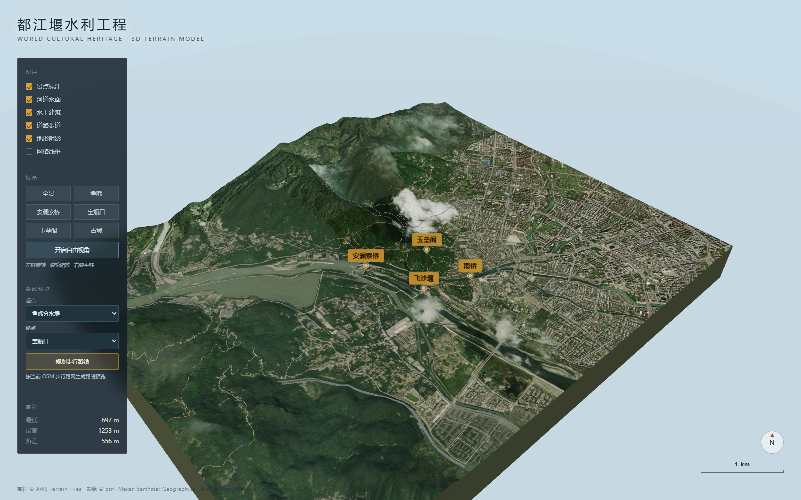
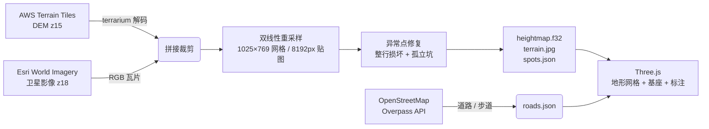

# 都江堰景区 3D 地形模型

基于 Three.js 的都江堰水利工程景区三维地形模型——真实 DEM 高程 + z18 卫星影像 + OSM 路网，
风格对标西湖 3D 地图（地形挤出块 + 地质剖面基座），并支持按路网生成步行路线预览。



## 快速开始

**环境要求**：Node.js 18+（推荐 20/22）。重新生成数据时才需要 Python 3.9+。

```bash
npm install          # 安装依赖（vite + three + puppeteer-core）
npm run dev          # 启动开发服务器 → http://127.0.0.1:5180
```

仓库已含一份生成好的数据，**首次运行可跳过数据下载**。
首次打开页面会加载约 22.6 MB 的卫星影像贴图，进度条走完即进入模型。

### 重新生成数据（可选）

```bash
python -m pip install pillow numpy
npm run fetch-data            # 下载 DEM(z15) + 影像(z18，约 2000 张瓦片)，3~6 分钟
python tools/fetch_osm.py     # 可选：重新抓取 OSM 路网（Overpass 偶尔限流，可重试）
```

### 打包

```bash
npm run build        # 产物在 dist/
npm run preview      # 本地预览构建结果
```

`dist/` 必须通过 HTTP 服务访问，直接双击 `index.html` 会因跨域读不到 `public/data` 下的高程与贴图。

## 功能

- **真实地形**：场景 6679m × 5195m，高程 697~1253m（落差 556m），比例 1:1 不放大
- **高分辨率影像**：z18 卫星影像 8192×6417（约 0.82m/像素）
- **地质剖面块**：地形边缘垂直挤出到底面，形成"浮岛"效果
- **河道水面**：岷江干流 / 外江 / 内江 / 柏条河四条水面条带。中心线用 Catmull-Rom 样条按 22m 加密、河宽平滑插值，水位沿程递减；着色器以卫星影像底色为色调基准，叠加多尺度波纹法线、菲涅尔天空反射、太阳高光、顺流涌纹与近岸白沫
- **水工建筑**：鱼嘴分水堤（行道树 + 观景亭）、飞沙堰、安澜索桥（木构门架桥塔、随桥面起伏的主索、1.15m 间距密排吊杆、石砌桥台）
- **沿江古建**：玉垒阁（八角楼阁式塔）、二王庙、伏龙观、南桥（廊桥）、城隍庙、玉垒关、秦堰楼、宣化门
- **道路与步道**：叠加 OSM 路网矢量面片（705 条 way），公路、游步道、台阶按等级分色分级宽度，无需放大即可辨认
- **步行路线规划**：在 OSM 路网上跑 Dijkstra，生成贴地发光路线并自动框选视角
- **26 个景点标注**：主要景点金色标签带高程信息，次要标签随距离淡出
- **相机浏览**：六个预设视角（全景 / 鱼嘴 / 安澜索桥 / 宝瓶口 / 玉垒阁 / 古城）+ 自由视角
- **图层控制**：景点标注 / 河道水面 / 水工建筑 / 道路步道 / 地形阴影 / 网格线框

## 界面与操作

| 操作 | 效果 |
|---|---|
| 左键拖动 | 旋转 |
| 滚轮 | 缩放（常规下限 160m，自由视角 35m） |
| 右键拖动 | 平移 |
| 双击地形/建筑 | 重新设定环绕中心（仅自由视角） |
| 悬停景点标签 | 显示名称与高程 |
| 左侧「路线预览」 | 选起点、终点 → 规划步行路线，显示里程与预计时间 |

右下角比例尺随镜头距离实时换算，罗盘指示正北。

## 路线规划

- 以 OSM 道路的原始节点构建无向图，`motorway` 不参与步行
- 边权 = 实际长度 × 等级系数：台阶 1.35、小径/土路 1.18、主干道 1.12、其余 1.0
- 起点、终点吸附到最近路网节点（超过 180m 判定不可达）
- 采用二叉堆优化的 Dijkstra，步行速度按 76 m/min（约 4.6 km/h）估算时间
- 路线几何沿每段按 4m 采样 DEM 高程，贴地 3.2m 绘制双层发光线

## 项目结构

```
├── index.html              # 页面骨架（图层 / 视角 / 路线预览 / 高程面板）
├── src/
│   ├── main.js             # 渲染核心（地形网格 / 基座 / 标注 / 视角 / 交互 / UI 绑定）
│   ├── geo.js              # 经纬度 ↔ 场景坐标、按 DEM 采样高程
│   ├── water.js            # 河道中心线样条加密 + 水面条带几何 + 水面着色器
│   ├── structures.js       # 鱼嘴 / 飞沙堰 / 索桥 / 南桥 / 塔 / 庙宇 / 城门建模
│   ├── roads.js            # OSM 路网 → 贴地带状面片
│   ├── navigation.js       # 路网图 + Dijkstra 最短路 + 路线发光叠层
│   └── style.css           # 界面样式
├── tools/
│   ├── build_terrain.py    # 数据管线：下载 DEM+影像 → 拼接裁剪 → 生成产物
│   ├── fetch_osm.py        # 抓取 OSM 道路与步道 → roads.json
│   ├── test_terrain.py     # 数据验收：高程范围 / 关键点位 / 点位清单（33 项）
│   ├── shot.mjs            # 无头浏览器截图（渲染取证）
│   └── test_render.py      # 渲染验收：像素统计（28 项）
└── public/data/
    ├── heightmap.f32       # 高程网格（Float32, 1025×769，约 6.5m/格）
    ├── terrain.jpg         # 卫星影像贴图（8192×6417，约 0.82m/像素，22.6 MB）
    ├── roads.json          # 路网（705 条 way，15 个等级）
    ├── spots.json          # 26 个景点（坐标 / 高程 / 停留时长 / 标签）
    └── meta.json           # 场景元数据
```

## 数据管线



数据源与已知问题：

- **高程**：AWS Terrain Tiles（terrarium 编码），z15 精度约 30m
- **影像**：Esri World Imagery z18（原生约 0.5m/像素，输出重采样到约 0.82m/像素），仅用于教学研究，请勿商用再分发；个别缺失瓦片自动回退到父级放大
- **路网**：OpenStreetMap（ODbL），由 `tools/fetch_osm.py` 抓取；渲染时按 bbox 裁剪，避免跨出地形块
- **已知缺陷**：z15/25811/13413 瓦片存在整行损坏（读出 -2352m），管线中 `repair_dem()` 用绝对合理性过滤 + 垂直插值修复整行损坏，再用 3×3 邻域中位数剔除孤立单点坑，合计修复 222 个点
- DEM 对玉垒阁这类山顶建筑会削峰（标称 865m，DEM 约 790m），属正常现象
- 玉垒山一带影像本身有云，属 Esri 源数据的云层，与渲染清晰度无关

## 性能提示

8192px 影像解码后约占 210 MB 显存（含 mipmap 约 280 MB）。若在核显笔记本上出现掉帧或加载失败，
把 `tools/build_terrain.py` 里的 `IMG_OUTPUT_W` 调回 `4096` 重新生成即可（显存降到约 53 MB）。

## 测试

```bash
npm run test:data             # 数据验收（33 项）
npm run dev                   # 另开一个终端启动服务器
npm run test:render           # 截图 + 渲染像素验收（28 项，需要本机 Edge）
```

`tools/shot.mjs` 中写死了 Edge 路径 `C:/Program Files (x86)/Microsoft/Edge/Application/msedge.exe`，
换机器需修改。

数据验收的关键断言：高程范围落在河谷 697~715m、山地可达 1253m；鱼嘴、宝瓶口、离堆公园等
关键点位高程与实地一致；所有景点在 bbox 内且 id 唯一。

渲染验收的关键指标：模型占画面 35%~97%、中部有主体、有植被绿和水体蓝、亮度 σ>18（立体光影）、
边缘密度>6%（影像纹理）。

## 坐标系

- 高程网格：WGS-84 经纬度，行优先，左上（西北）原点
- 场景：X 向东、Z 向南、Y 向上，单位为米
- 场景中心 `(103.610, 31.0065)` 对应 `(0, 0)`

## 数据版权

- 高程：© AWS Terrain Tiles
- 影像：© Esri, Maxar, Earthstar Geographics
- 路网：© OpenStreetMap contributors（ODbL）
